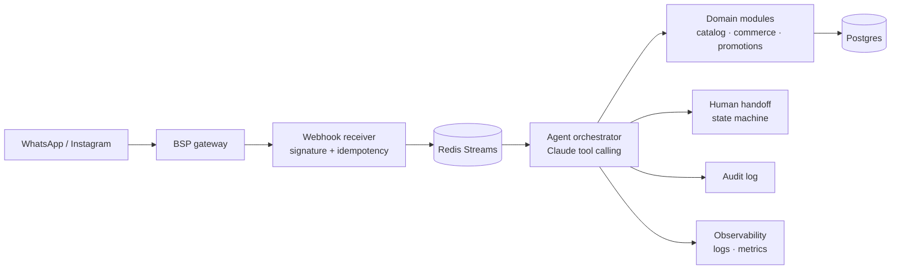

# agent-sale

> **A production WhatsApp sales agent built with TypeScript, Fastify and Claude tool calling.**

[](https://github.com/devrochy/agent-sale/actions/workflows/ci.yml)
[](LICENSE)
[](package.json)

**TL;DR** — agent-sale runs a complete sales conversation over WhatsApp: it verifies
incoming webhooks, deduplicates events, orchestrates turns with Claude tool calling and
executes business actions (catalog, quotes, orders, promotions, payments) against
Postgres — with a human handoff state machine, an audit log and full observability.

| | |
|---|---|
| **Problem** | A business answers sales conversations manually on WhatsApp, losing messages, context and sales outside working hours. |
| **What I built** | A modular monolith: gateway with webhook signature verification and idempotency, Redis-backed queue, agent orchestrator with Claude tool calling, domain modules with strict validation, and an admin panel. |
| **Proof** | 227 commits · 50 test files · 39 ADRs · 23 documented phases · CI/CD to Fly.io with staging and production environments. |

## What it does

- **Claude tool calling:** the model proposes, the tools decide. Every business
  action is validated against Postgres before it executes.
- **Catalog and commerce:** inventory, quotes, orders, a promotions engine with
  eligibility rules and customer classification, and payment links (Wompi) with
  signature verification.
- **Reliability by design:** webhook signature check (`X-Hub-Signature-256`),
  idempotency by event id, a Redis Streams queue that absorbs traffic spikes,
  price guardrails and a kill switch.
- **Human handoff:** an explicit state machine decides when to escalate to a
  person — the LLM is one signal, not the authority.
- **Multichannel:** Meta WhatsApp and Instagram adapters (with a Twilio BSP
  adapter), brand voice via RAG, proactive follow-ups inside the 24-hour window
  and scheduled reminders.
- **Operations:** structured logs (pino), metrics and tracing, audit log of
  every tool call, admin panel with per-admin permissions and encrypted BYOK
  secrets.

## Architecture



## Quickstart

```bash
cp .env.example .env     # fill the dev-only values documented inside
docker compose up -d     # Postgres + Redis
npm install
npm run migrate          # schema migrations
npm run dev
```

All calls to Claude, Twilio and Meta are mocked by default in development and CI
— no external accounts needed to run the suite.

## Commands

| Command | What it does |
|---|---|
| `npm run dev` | Start the API in watch mode |
| `npm test` | Unit tests (Vitest) |
| `npm run test:integration` | Integration tests (Postgres + Redis) |
| `npm run test:all` | Full suite |
| `npm run lint` / `npm run format` | ESLint / Prettier |
| `npm run migrate` | Run migrations (`node-pg-migrate`) |

## Testing and CI

Every PR runs lint, unit tests, integration tests, TypeScript build and a Docker
image build. Merges to `develop` deploy to a Fly.io staging environment; merges
to `main` deploy to production behind a manual approval environment.

## Observability and security

- Structured JSON logs (pino) exportable to Grafana Cloud Loki (compose file included).
- Webhook signature verification and event idempotency at the gateway.
- Least-privilege database role for the runtime (`agent_sale_app`).
- Encrypted storage for tenant-provided LLM keys (BYOK) and per-admin sessions.
- Login rate limiting and audit log of agent decisions.

## Documentation

The full engineering history lives in Spanish under [`docs/`](docs/): 39 ADRs,
23 phases, the architecture contract, the data model and the deployment runbook.

## License

MIT. See [LICENSE](LICENSE).

## Contact

[LinkedIn](https://linkedin.com/in/robinson-aguilar-ramirez-8970a1129) · [Email](mailto:devrochy@gmail.com)
